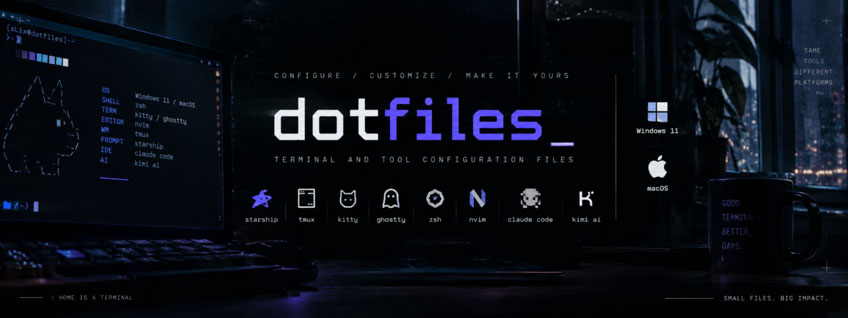

<div align="center">




My terminal setup for macOS and Windows. Same tools on both machines, Rose Pine
on the Mac and a black-and-grey `noir` look in Windows Terminal.

</div>

---

## Requirements

| | |
|---|---|
| **macOS** | `git` and [Homebrew](https://brew.sh). The installer pulls everything else through the `Brewfile`. |
| **Windows** | Windows 10 or 11, `git` and `winget` (the "App Installer" app from the Microsoft Store, preinstalled on Windows 11). Windows Terminal is built into Windows 11; on Windows 10 get it with `winget install Microsoft.WindowsTerminal`. |

## Install

**macOS**

```bash
git clone https://github.com/sLix1337x/dotfiles.git ~/dotfiles
cd ~/dotfiles && ./install.sh
```

**Windows** (PowerShell; one UAC prompt for PowerShell 7)

```powershell
Set-ExecutionPolicy -Scope CurrentUser RemoteSigned   # once, Windows blocks scripts by default
git clone https://github.com/sLix1337x/dotfiles.git $env:USERPROFILE\dotfiles
cd $env:USERPROFILE\dotfiles; .\install.ps1
```

Run them as often as you want. Old files get a `.bak` copy with a timestamp,
finished steps are skipped. Want to look before you leap: `--dry-run` on
macOS, `-WhatIf` on Windows.

**With an AI assistant** (Claude Code, Codex, Cursor, ...)

Paste this into it:

```
Set up my terminal like https://github.com/sLix1337x/dotfiles.
Clone it and follow AGENTS.md in the repo.
```

[AGENTS.md](AGENTS.md) walks the assistant through the prerequisites, a dry
run, what gets replaced, and how to check the result.

## What's in it

| | Tools |
|---|---|
| **Prompt** | Starship |
| **Terminals** | Kitty, Ghostty, Alacritty, Windows Terminal |
| **Shells** | Zsh, Bash, PowerShell 7 / 5.1 |
| **Editors** | Neovim, Zed |
| **CLI** | tmux, bat, eza, fzf, ripgrep, zoxide, delta, lazygit, yazi, btop, fastfetch |
| **Theme** | noir (Windows), Rose Pine / Catppuccin, JetBrainsMono Nerd Font |
| **AI CLIs** | Claude Code, Kimi, Codex ([Windows/ai](Windows/ai)) |

### On Windows

| | |
|---|---|
| **Welcome screen** | Every new tab greets you with your computer name in thin box letters and the commands below |
| `dev` / `Ctrl+Alt+d` | Splits the tab: lazygit (or yazi) and btop on the left, your shell on the right |
| `panel` / `Ctrl+Alt+p` | Side panel with the folder's files, git status and running dev servers; follows your `cd` |
| `y` | yazi file manager, the shell stays where you quit it |
| `cd tree` / `Ctrl+Alt+z` | Fuzzy-jump to a project folder |
| `z <name>` | Jump to a folder you use often (zoxide) |
| `Ctrl+Shift+g` | Glow shader on / off |

More keys, the look and how to change it: [Windows/README.md](Windows/README.md).

```
dotfiles/
├── install.sh      → Mac-OS/install.sh
├── install.ps1     → Windows/install.ps1
├── AGENTS.md       setup guide for AI assistants (CLAUDE.md points here)
├── Mac-OS/         zsh, tmux, git, terminals, editors, CLI configs
└── Windows/        PowerShell profile, Windows Terminal (theme, welcome
    │               screen, side panel, glow), starship, lazygit, btop
    └── ai/         Claude Code, Kimi, Codex configs (`install.ps1 -AI`)
```

Details per platform: [Mac-OS/README.md](Mac-OS/README.md) · [Windows/README.md](Windows/README.md)

## Updating

```bash
cd ~/dotfiles && git pull
```

On macOS that's it, the configs are symlinks into the repo. On Windows the
files are copies, so run `.\install.ps1` again afterwards (add `-SkipTools
-SkipFont` to only refresh the configs).

## Undoing it

Nothing gets deleted. Every file the installer replaced sits next to the new
one as `<name>.<timestamp>.bak`; rename it back to restore. The tools stay
installed, remove them with `brew uninstall` or `winget uninstall` if you want
them gone.

## Make it yours

Edit the installed files, not the repo, unless you keep your own fork (a fork
plus `git pull` is the easy way to keep your changes across updates).

| Change | Where |
|---|---|
| Prompt layout and segments | `~/.config/starship.toml` |
| Windows colors, background, transparency | Windows Terminal `settings.json` (Settings → Open JSON file) |
| Welcome screen tagline | `$global:WelcomeTagline = '...'` in your PowerShell profile |
| Folders for the `cd` shortcuts | `$CdRoots` in your PowerShell profile |
| Glow strength | `~\.config\wt\glow.hlsl` |

## Good to know

- Git name and email are not in here. On macOS the installer drops a
  `~/.gitconfig.local` for you, fill that in. On Windows your existing
  `~\.gitconfig` is left alone.
- tmux plugins are not included. Get [tpm](https://github.com/tmux-plugins/tpm),
  then hit `prefix + I`.
- Background images for Kitty and Ghostty are commented out. Point them at
  something of your own.
- The Windows profile's `ll`, `la`, `tree` and `grep` are built-in PowerShell
  versions on purpose: some anti-cheat drivers (FACEIT) add seconds to every
  launch of an unsigned program. eza, bat and rg are still installed for when
  you call them directly.

## Troubleshooting

| Problem | Fix |
|---|---|
| "running scripts is disabled on this system" | `Set-ExecutionPolicy -Scope CurrentUser RemoteSigned`, then open a new window |
| Windows Terminal can't find `pwsh.exe` (error `0x80070002`) | PowerShell 7 is missing: `winget install Microsoft.PowerShell`, restart Windows Terminal |
| Icons show up as boxes or `?` | The Nerd Font hasn't loaded yet. Close every Windows Terminal window and start it again |
| `winget` not found | Install "App Installer" from the Microsoft Store |
| macOS: `brew: command not found` | Install Homebrew from [brew.sh](https://brew.sh), then run `./install.sh` again |

## Credits

[Rose Pine](https://rosepinetheme.com), [Catppuccin](https://catppuccin.com),
[Nerd Fonts](https://www.nerdfonts.com), [Starship](https://starship.rs) and
the authors of every tool listed above.

## License

[MIT](LICENSE). Copy it, change it, make it yours.
